

Critical decisions in the modern LLM pipeline, framed as optimization problems.
{: .section-tagline}

  

    
Hyperparameter optimization MLP emulator

    
LoRA fine-tuning of Qwen3-4B/8B on OpenMathInstruct-2, evaluated on MATH-500.

    <table>
      <thead>
        <tr><th>Problem</th><th>Dim</th><th>Challenges</th></tr>
      </thead>
      <tbody>
        <tr><td>HPO</td><td>7</td><td>mixed variables</td></tr>
        <tr><td>HPO-MF-Cont</td><td>8</td><td>mixed variables, continuous fidelity</td></tr>
        <tr><td>HPO-MF-Disc</td><td>8</td><td>mixed variables, discrete fidelity</td></tr>
      </tbody>
    </table>
  

  

    
Data mixture optimization MLP emulator

    
Two-stage mixtures of TULU-3 instruction, math, and code data, evaluated on IFEval, MATH-500, and MBPP+.

    <table>
      <thead>
        <tr><th>Problem</th><th>Dim</th><th>Challenges</th></tr>
      </thead>
      <tbody>
        <tr><td>DMO</td><td>6</td><td>simplex constraint</td></tr>
        <tr><td>DMO-MO</td><td>6</td><td>simplex constraint, multi-objective</td></tr>
        <tr><td>DMO-Het</td><td>6</td><td>simplex constraint, heteroscedastic noise</td></tr>
      </tbody>
    </table>
  

  

    
Prompt optimization Tabular

    
Discrete search over 5,014 prompts, using Matryoshka embeddings at four truncation dimensions (128–768).

    <table>
      <thead>
        <tr><th>Problem</th><th>Dim</th><th>Challenges</th></tr>
      </thead>
      <tbody>
        <tr><td class="wrap">PO-128/<wbr>256/<wbr>512/<wbr>768</td><td>128–768</td><td>high-dimensional</td></tr>
      </tbody>
    </table>
  

  

    
Parallelism configuration optimization Tabular

    
Discrete search over parallelism configurations on 16–64 GPUs, maximizing training throughput without running out of memory.

    <table>
      <thead>
        <tr><th>Problem</th><th>Dim</th><th>Challenges</th></tr>
      </thead>
      <tbody>
        <tr><td class="wrap">PCO-16/<wbr>32/<wbr>64</td><td>8</td><td>black-box constraint</td></tr>
      </tbody>
    </table>
  

MLP emulators backed by 22k+ real LLM experiments, queried in milliseconds.
{: .section-tagline}

They approximate the real objective landscape at negligible query cost, validated against real runs on held-out configurations (Spearman ρ ≥ 0.76, R² ≥ 0.63).

  

    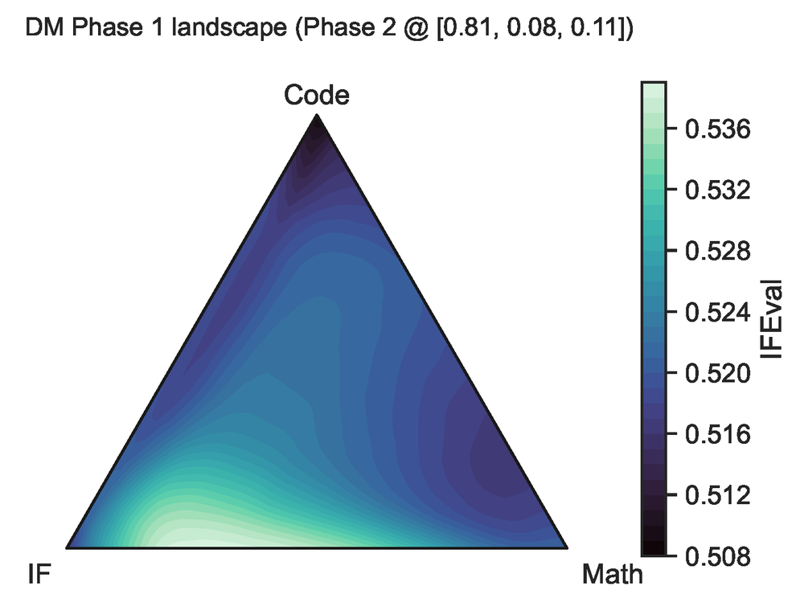
    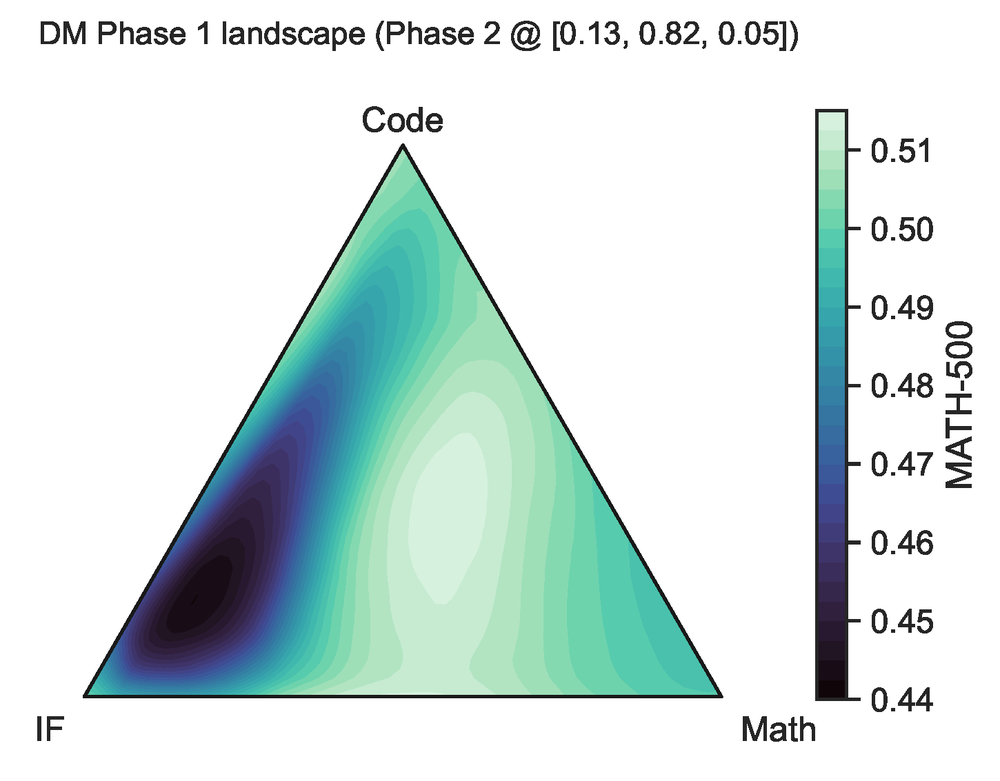
    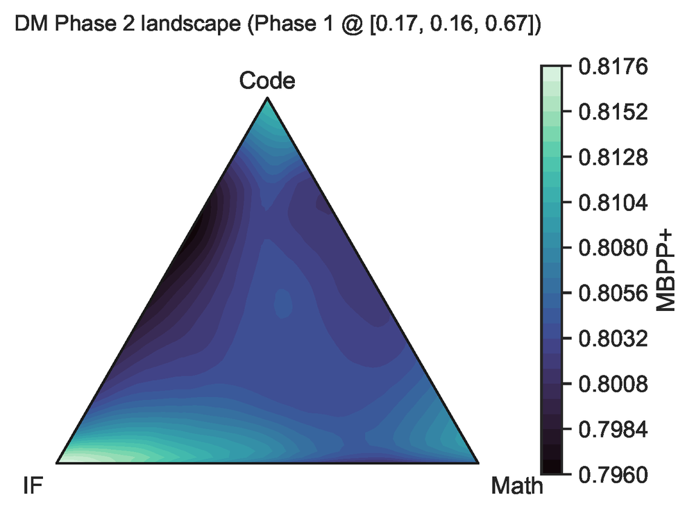
  

  
<strong>2D slices of the DMO emulator landscape</strong> across instruction-following, math, and code data proportions. The varied terrain reflects real trade-offs in the underlying LLM experiments.

BO generally wins, but no single method wins everywhere.
{: .section-tagline}

We benchmark 30+ Bayesian optimization (BO) and black-box methods across all 13 problems. Four key findings are presented here.

  

    
HPO

    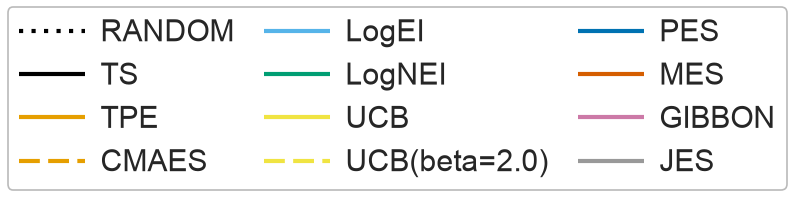
    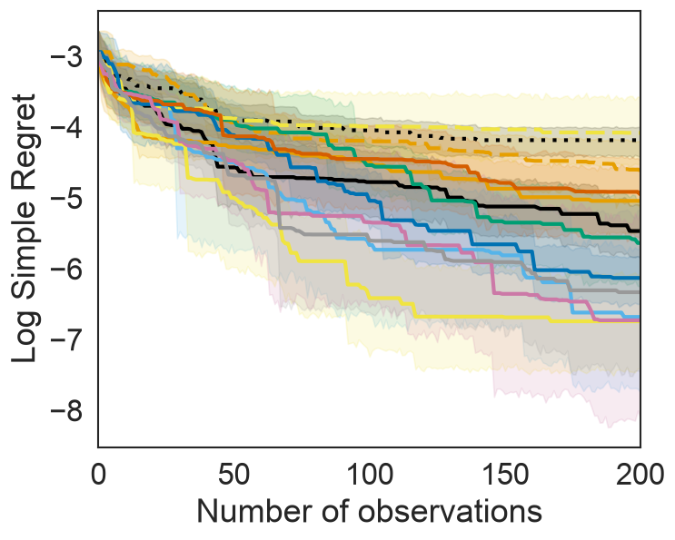
    
GP-based methods (GIBBON, UCB, LogEI) outperform HPO baselines (TPE, CMA-ES), and their compute overhead is negligible next to real LLM training costs.

  

  

    
DMO-MO

    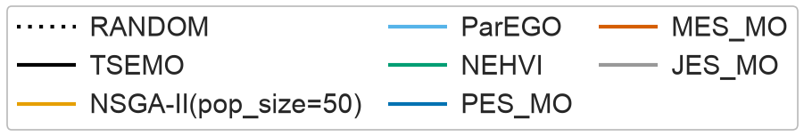
    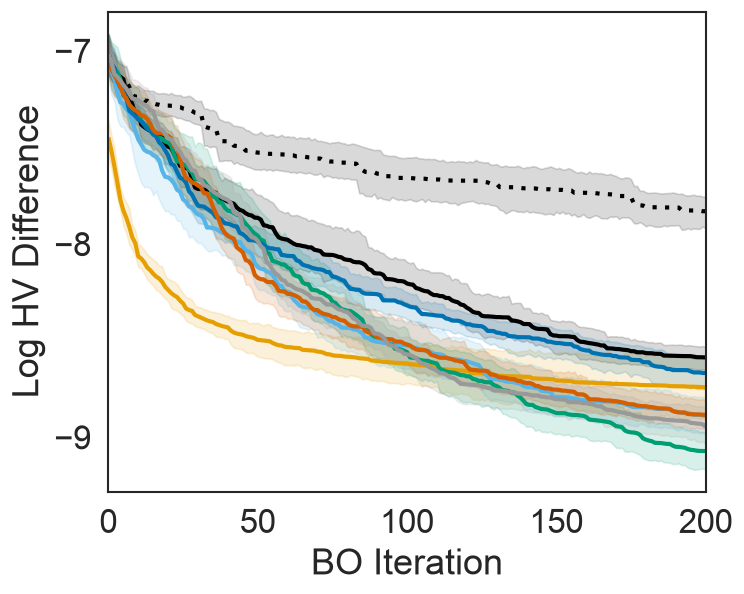
    
NSGA-II leads early, but NEHVI overtakes it after ~100 iterations while using 50× fewer evaluations per iteration.

  

  

    
PO-768

    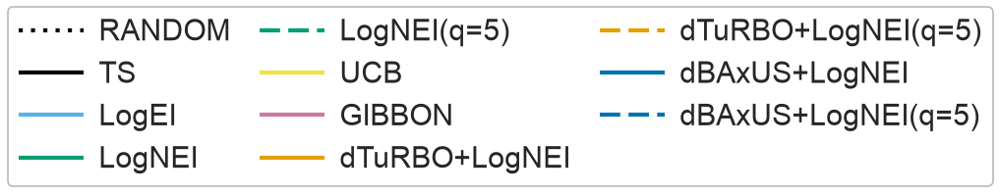
    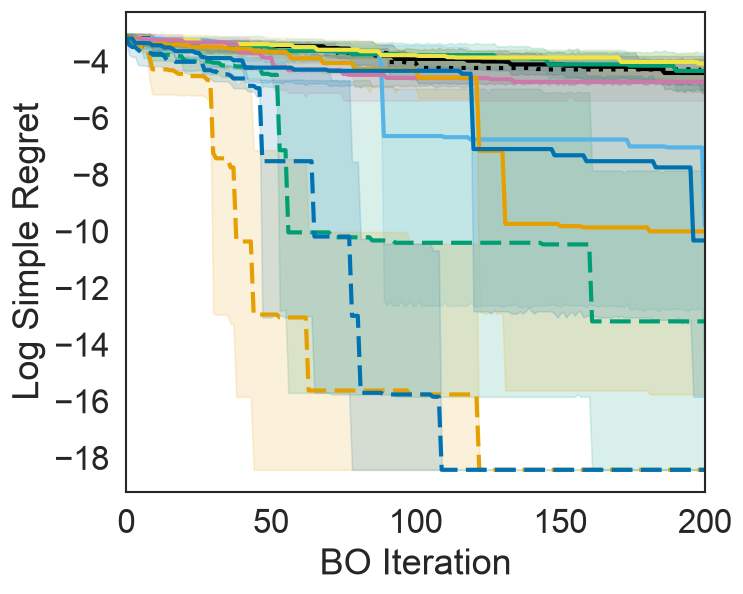
    
Trust-region methods adapted for discrete candidate sets (dTuRBO, dBAxUS) are essential, approaching the optimum within 200 iterations with batching.

  

  

    
PCO-64

    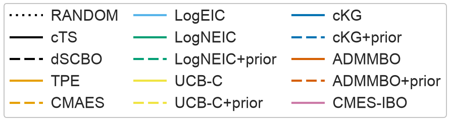
    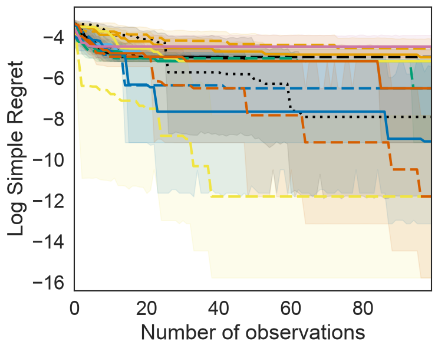
    
Near-optimal plateaus stall most methods behind random search, but parallelism priors help: UCB-C+prior finds the optimum in 5 of 10 seeds, up from 0.

  

Evaluate on [[bolt]].
{: .section-tagline}
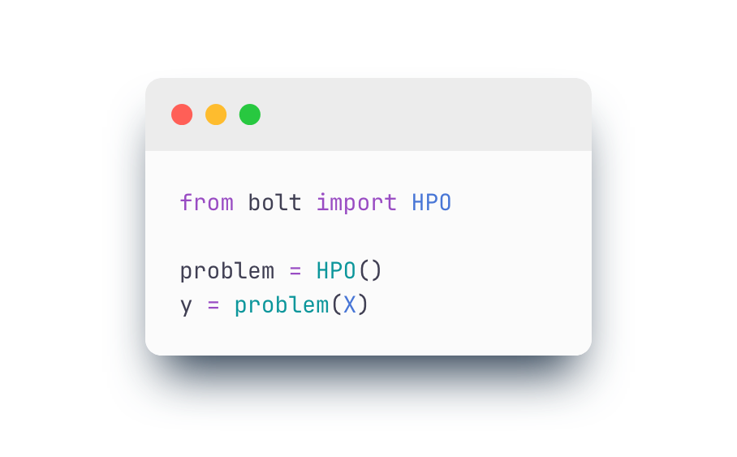
{: .figure-half .figure-right .no-border style="margin-top:0rem"}

[[bolt]] is built for BBO researchers. Every problem subclasses BoTorch's `BaseTestProblem`, so your existing code plugs straight in. Emulator weights and tabular data are fetched automatically from [HuggingFace](https://huggingface.co/collections/Glow-AI/bolt) on first use.

The benchmark is not limited to the 13 bundled problems. You can construct new optimization settings (contextual, etc.) using the public emulators or underlying data, without running any new LLM experiments.

Install the Python package, point your optimizer at a [[bolt]] problem, and you have a reproducible, grounded evaluation. See the [documentation](https://bolt-bench.readthedocs.io/en/latest/) to get started.
